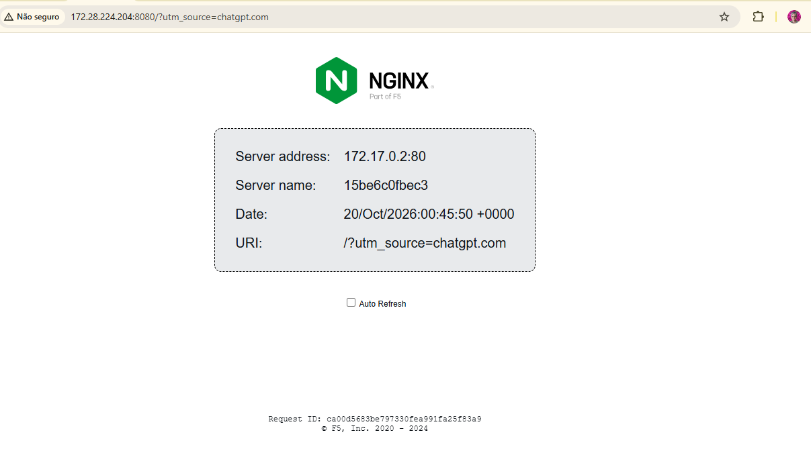
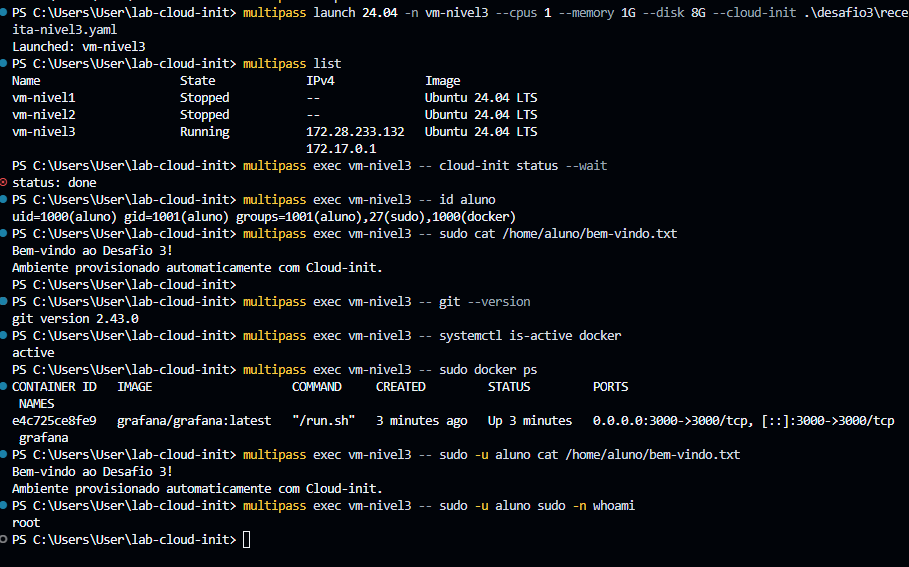

# Curso DevOps | FAP Aponti Academy

## Laboratório Prático — Cloud-init e Multipass

## Objetivo

Automatizar o provisionamento de máquinas virtuais Ubuntu utilizando **Multipass** e **Cloud-init**, aplicando conceitos de infraestrutura como código, administração Linux e execução de serviços em containers Docker.

## Tecnologias utilizadas

- Windows 11 Pro e Hyper-V
- Multipass
- Ubuntu 24.04 LTS
- Cloud-init (YAML)
- Nginx
- Docker
- Git
- Grafana

## Desafio 1 — Servidor Nginx automatizado

**Objetivo:** provisionar uma VM Ubuntu, instalar Nginx e disponibilizar uma página HTML personalizada utilizando Cloud-init.

**Receita:** `desafio1/receita-nivel1.yaml`

```powershell
multipass launch 24.04 -n vm-nivel1 --cpus 1 --memory 1G --disk 8G --cloud-init .\desafio1\receita-nivel1.yaml
multipass exec vm-nivel1 -- cloud-init status --wait
```

**Resultado:** página HTML personalizada disponibilizada na porta 80.


## Desafio 2 — Docker e container Nginx

**Objetivo:** instalar o Docker automaticamente e executar a imagem `nginxdemos/hello`, publicando a porta 8080 da VM.

**Receita:** `desafio2/receita-nivel2.yaml`

```powershell
multipass launch 24.04 -n vm-nivel2 --cpus 1 --memory 1G --disk 8G --cloud-init .\desafio2\receita-nivel2.yaml
multipass exec vm-nivel2 -- cloud-init status --wait
multipass exec vm-nivel2 -- sudo docker ps
```

**Resultado:** container Nginx em execução, acessível pela porta 8080.



## Desafio 3 — Provisionamento com Docker, Git e Grafana

**Objetivo:** automatizar a instalação do Docker e Git, criar o usuário Linux `aluno`, configurar suas permissões, gerar um arquivo de boas-vindas e executar o Grafana em container.

**Receita:** `desafio3/receita-nivel3.yaml`

```powershell
multipass launch 24.04 -n vm-nivel3 --cpus 1 --memory 1G --disk 8G --cloud-init .\desafio3\receita-nivel3.yaml
multipass exec vm-nivel3 -- cloud-init status --wait
multipass exec vm-nivel3 -- id aluno
multipass exec vm-nivel3 -- sudo -u aluno cat /home/aluno/bem-vindo.txt
multipass exec vm-nivel3 -- sudo -u aluno sudo -n whoami
multipass exec vm-nivel3 -- sudo docker ps
```

**Resultados validados:**

- Usuário `aluno` criado e incluído nos grupos `sudo` e `docker`.
- Arquivo `/home/aluno/bem-vindo.txt` criado.
- Git instalado.
- Docker ativo.
- Grafana acessível pela porta 3000.
- Permissão `sudo` sem senha validada em ambiente de laboratório.




## Troubleshooting — Hyper-V

Durante a preparação do ambiente Windows, o Multipass apresentou a mensagem `The Hyper-V service does not exist`.

A investigação identificou ausência do serviço `vmms` e corrupção reparável no repositório de componentes do Windows.

Foram utilizados os comandos:

```powershell
DISM /Online /Cleanup-Image /ScanHealth
DISM /Online /Cleanup-Image /RestoreHealth
sfc /scannow
sc.exe query vmms
```

Após o reparo e a reinicialização do Windows, o serviço `vmms` passou a funcionar e foi possível executar os três desafios.

## Considerações finais

Os três desafios foram executados e validados em máquinas virtuais Ubuntu provisionadas com Multipass e Cloud-init.

O laboratório permitiu aplicar conceitos de automação de infraestrutura, configuração declarativa, containers Docker, serviços Linux e diagnóstico de problemas de virtualização.

**Observação:** os endereços IP das VMs são locais e podem mudar em novas execuções. As máquinas foram preservadas em estado `Stopped` após os testes.